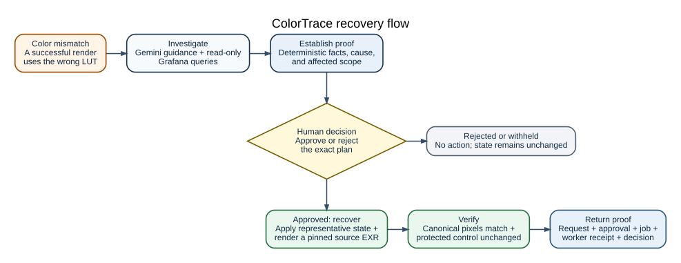

# ColorTrace

## A successful render can still be the wrong color

A render farm can finish every job and still publish inconsistent color. One worker can resolve a
different lookup table (LUT), produce valid files, and leave artists to compare frames by eye while
the cause remains hidden across logs, metrics, traces, configuration, and asset lineage.

ColorTrace turns that investigation into one controlled recovery flow:

**Detect → Explain → Approve → Verify**

It finds the mismatch, explains the affected scope, prepares a minimal recovery, waits for a human
decision, and verifies the result before it records a receipt.



## How it works

| Stage | What ColorTrace does | What the operator sees |
| --- | --- | --- |
| Detect | Correlates render telemetry, configuration, and asset lineage. | The expected image, observed fault, pixel difference, and affected scope. |
| Explain | Uses Gemini 3.5 Flash through Vertex AI and Google ADK to select one bounded, read-only Grafana MCP query at a time after a required alert baseline. Deterministic validators decide when the evidence is sufficient and establish the facts. | A concise diagnosis, the selected evidence path, and the proposed repair. |
| Approve | Builds an exact action plan and requires a human to approve or reject it. | The affected exemplar, protected control, exact command, and explicit approval boundary. |
| Verify | Applies the representative simulator recovery, runs a fresh in-host OpenImageIO/OpenColorIO render, and verifies its canonical pixels before returning the result. | A new recovered preview bound to the request, approval, render job, worker receipt, and decision. |

Gemini helps navigate the investigation. It cannot declare facts, expand the recovery scope,
authorize an action, execute a command, or close a run. Those boundaries belong to deterministic
code and the human operator.

## The canonical recovery

The included scenario models a subtle fault: one worker resolves a shadowed `show_look.cube` LUT.
Its renders complete normally, but their color differs from the approved look.

ColorTrace identifies three affected frames and one affected derivative. It also identifies three
safe assets that must remain unchanged. The proposed recovery contains five commands:

1. Quarantine the incorrect LUT and install the approved replacement.
2. Rerender affected frame one.
3. Rerender affected frame two.
4. Rerender affected frame three.
5. Rerender the affected derivative.

The operator sees that scope before approval. After execution, ColorTrace compares the recovered
output with the expected image, checks the protected assets again, reads fresh telemetry, and then
offers closure. The terminal receipt preserves the investigation, decision, action, and result as
one reviewable record.

All media, telemetry, and action targets in this repository are generated. ColorTrace changes only
the included simulator. It does not connect to a production media system.

## Designed for bounded authority


The product separates useful AI assistance from action authority:

- Grafana MCP exposes a fixed read-only query catalog with server-owned arguments.
- After a required alert baseline, Gemini 3.5 Flash selects one useful next query at a time, up to
  a fixed investigation budget.
- The visible trace binds each model selection to the Grafana result and deterministic disposition.
- Deterministic validators decide whether the evidence, scope, and proposed plan agree.
- A human approves the displayed targets and exclusions with a one-time challenge.
- The recovery service consumes that authority once and can change only the local simulator.
- Fresh post-action checks and a second human decision are required before closure.

Missing, stale, inconsistent, or unavailable proof stops the workflow without an action. A lost
response can be retried safely because mutation requests retain their original identity.

## Hosted open-film proof

The canonical browser experience includes three distinct Tears of Steel failure classes: resource
resolution drift, configuration rollout drift, and a stale derivative cache. Each investigation
uses generated telemetry, read-only Grafana MCP queries, and deterministic reconciliation. After
one result, the interface invites the operator to run a second class and compares the two live
diagnoses side by side.

Recovered pixels are not exposed as a catalog asset. They become available only after the operator
approves a supported action. The existing Compute Engine runtime then processes a pinned source EXR
with the approved color configuration, checks the full-resolution canonical pixel digest, creates a
fresh preview, and binds it to the request, approval, render job, worker receipt, and decision. A
render, digest, timeout, or binding failure stops the simulator mutation and withholds the result.

The live flow is deliberately representative: one affected exemplar and one protected control. The
recorded 99-case, 720-artifact benchmark is historical evidence and is presented separately from a
live run. Neither is described as production media evidence.

## Try the local demonstration

Install Docker and GNU Make, then run:

```sh
make demo
```

The local demonstration creates the generated color incident, presents the five-command plan, and
waits for the approval phrase before it changes the ephemeral simulator. It runs without network
access, cloud credentials, Grafana, or Vertex AI. The command prints the path to its private receipt
under `.cache/`.

Use this command after an interrupted run:

```sh
make demo-clean
```

For development, bootstrap the pinned toolchain and run the focused checks:

```sh
make bootstrap
make check-fast
```

Run `make check` before a change is ready for review.

## Run the complete browser experience

The gated single-host profile runs the web application, workflow runtime, in-host render worker,
Grafana MCP, and telemetry services on one Compute Engine VM. Caddy Basic Auth and TLS form the only
public network entry point. The runtime and observability services remain on private container or
host-loopback paths.

Use the [single-host runbook](docs/operations/single-host.md) to build the images, create the host,
open the browser workflow, stop or resume the VM, and contain an unhealthy deployment.

This profile is a controlled demonstration environment. It uses one shared access gate, one
persistent host, and generated data. It does not provide per-user accounts, high availability, or
production media integration.

## Repository map

- `packages/web` contains the browser experience.
- `packages/api` assembles the hosted workflow and its demo facade.
- `packages/investigation` and `packages/grafana-mcp` contain the bounded AI investigation path.
- `packages/validators`, `packages/response-plans`, and `packages/recovery` enforce the
  deterministic decision and authority boundaries.
- `packages/simulator` and `packages/fixture-generator` provide the generated scenario and action
  target.
- `packages/telemetry` provides the logs, metrics, and traces used by the investigation.
- `containers` contains the six focused container definitions.
- `infra/single-host` contains the gated demonstration topology and operator scripts.

Read [SECURITY.md](SECURITY.md) before operating the hosted profile. Architecture decisions are in
[`docs/adr`](docs/adr), and editable diagram sources are in
[`docs/architecture`](docs/architecture).

## License

Apache License 2.0. See [LICENSE](LICENSE).
