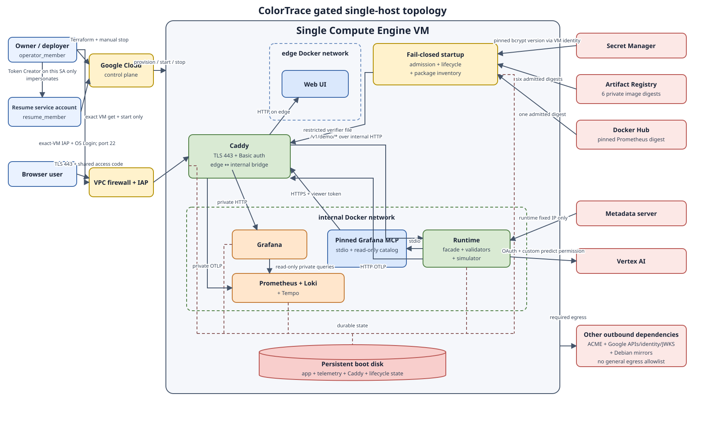

# ColorTrace

ColorTrace is a human-authorized recovery workflow for a synthetic color-pipeline incident. It
uses bounded Gemini analysis and read-only Grafana MCP queries to explain a visible color fault.
It then prepares one exact simulator action, shows the affected and safe outputs, and requires a
human to approve and verify the recovery.

ColorTrace does not connect to a production media system. The included scenario, images,
telemetry, and action target are generated data. The model can propose an explanation, but it
cannot authorize an action, execute an action, classify authoritative facts, or close a recovery.

## Operating profiles

| Profile | Purpose | External services | Action target |
| --- | --- | --- | --- |
| Local demonstration | Exercise one deterministic plan and simulator action from a clean checkout | None | Ephemeral local simulator |
| Gated single host | Exercise the complete visual investigation, approval, recovery, receipt, and reset flow | Vertex AI, Google Cloud control-plane services, ACME, and pinned image sources | Persistent simulator on the isolated host |

The local profile is the default developer path. It does not contain the Grafana MCP binary and
does not make network calls. The gated profile runs only on the single-host topology in
[`infra/single-host`](infra/single-host). It exposes the browser application and the demo facade
through one TLS and access-code gate.

## Shot-Safe Color Recovery

The gated workflow has these stages:

1. The browser starts the canonical synthetic scenario with a new nonce and idempotency key.
2. Gemini selects and orders queries from a fixed read-only Grafana MCP catalog. Deterministic
   validators establish the returned logs, metrics, traces, and scope facts; the response-plan
   service creates the proposed action from those facts.
3. The browser shows the expected, observed, and difference images. It keeps illustrative names
   separate from authoritative numeric proof.
4. A human retypes the one-time nonce and approval phrase. The request also binds the run version,
   incident version, plan version, plan digest, and target digest.
5. The service consumes that authority for one simulator action. It verifies the recovered output,
   the safe complement, and post-action telemetry before it permits closure.
6. A human confirms the recovered image. ColorTrace stores an immutable terminal receipt that
   binds the investigation proof, execution proof, visual digests, closure, source, and image
   provenance.
7. Reset restores the authored synthetic scenario. A new run cannot start until the prior terminal
   run has a completed reset.

Requests that lose their response are safe to retry with the same idempotency key. A restart
reconciles stored operations before the service accepts new mutations. Missing proof, changed
bindings, stale versions, unavailable evidence, and unknown action outcomes stop the workflow.

A configuration digest identifies configuration bytes; it does not prove that two runs have the
same current LUT or simulator publication. ColorTrace binds the action and receipt to the observed
state, versions, target, publication transition, and proof digests as separate facts.



See the [single-host architecture decision](docs/adr/0011-single-host-staging.md) for the topology
and trust boundaries.

## Development

Local development requires Docker and GNU Make. Bootstrap the pinned toolchain and workspace
dependencies, then run the complete check suite:

```sh
make bootstrap
make check
```

The checks run through pinned tool images. The local commands require no cloud or service
credentials. Use `make check-fast` while iterating and `make check` before a change is ready for
review.

## Local demonstration

From a clean checkout, run:

```sh
make demo
```

The command builds an immutable image for the current commit, starts it without network access,
creates a deterministic synthetic color incident, and displays the proposed simulator plan. Type
the requested approval phrase to authorize one local action. The resulting JSON shows the human
approval, service-only dispatch, action outcome, unchanged safe-frame digest, side-effect-free
replay, and exact commit, tree, image, and configuration bindings. Private run receipts are retained
under `.cache/` at the path printed by the command.

The local demonstration does not require Grafana, Vertex AI, cloud credentials, or a hosted
service. It exposes no network endpoint and does not include the private Grafana MCP binary. It
uses only generated data and an ephemeral local simulator workspace. It is not a production
deployment or a statistical reliability claim.

Successful output is one JSON receipt with `action.action_count` set to `1`,
`replay.generation_unchanged` set to `true`, and `safety.safe_frame_digest_equal` set to `true`,
followed by the private receipt directory.

If approval is withheld or invalid, no action is admitted and the simulator publication remains
unchanged. To remove the exact demo container or image reference after an interrupted run, use:

```sh
make demo-clean
```

No external or shared product state is mutated. Rollback consists of stopping the demo and running
that cleanup command. Retained JSON receipts may be removed separately when they are no longer
needed.

## Gated single-host operation

The hosted profile uses one Compute Engine VM with a persistent boot disk. Caddy is the only
service on the public network path. Grafana, Prometheus, Loki, Tempo, the runtime, and their control
interfaces remain on internal or host-loopback paths. SSH uses IAP and OS Login.

Use the [single-host runbook](docs/operations/single-host.md) to create the foundation, build and
scan digest-addressed images, admit the VM, operate the workflow, stop or resume the host, and
recover from interrupted requests. Do not put the access code, hosted address, cloud identifiers,
or generated receipts in tracked files.

The workflow receipt covers one investigation, authorized action, recovery, visual comparison,
and closure. The separate host-verification report covers deployment admission, every live image,
network routes, the metadata boundary, a fresh workflow, restart persistence, and reset. Neither
artifact substitutes for the other.

The host powers off seven days after a lifecycle generation first starts. A stop and resume within
that period retains the original activation time and persistent state. Startup does not serve an
expired generation and powers the VM off again. A new generation requires an explicit Terraform
apply.

## Limits

- The hosted topology is a controlled single-host environment. It has no high-availability or
  multi-region guarantee.
- The access code is one shared outer gate. It is not per-user application authorization.
- The canonical workflow can change only the local simulator publication. It cannot mutate a
  production color pipeline or media asset.
- Grafana MCP tools are read-only and limited to the checked-in query catalog.
- Model output is non-authoritative until deterministic validation binds the required structured
  facts.
- Receipts prove the inputs and transitions recorded by this implementation. They do not establish
  broad operational reliability.

Read [SECURITY.md](SECURITY.md) before operating the hosted profile.

## Implementation map

- The hosted integration is assembled by the
  [demo workflow](packages/api/src/colortrace_api/demo_workflow.py) and
  [durable facade](packages/api/src/colortrace_api/demo_facade.py).
- Human and service authority are enforced by the
  [response-plan service](packages/response-plans/src/colortrace_response_plans/service.py) and
  [recovery authority boundary](packages/recovery/src/colortrace_recovery/authority.py).
- Recovery failure handling and post-action proof live in the
  [recovery verifier](packages/recovery/src/colortrace_recovery/verifier.py).
- The canonical generated scenario comes from the
  [fixture generator](packages/fixture-generator/src/colortrace_fixture/fixture.py).
- Third-party provenance is recorded for the
  [fixture assets](packages/fixture-generator/THIRD_PARTY_NOTICES),
  [Grafana MCP binary](packages/grafana-mcp/THIRD_PARTY_NOTICES), and
  [telemetry stack](packages/telemetry/THIRD_PARTY_NOTICES).

## License

Apache License 2.0. See [LICENSE](LICENSE).
