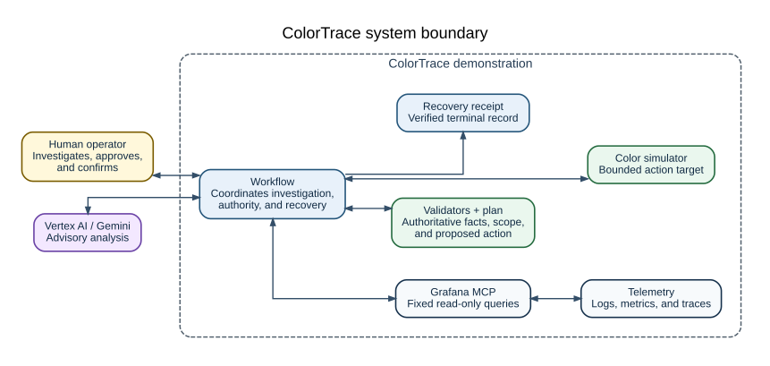

# Security policy

## Report a vulnerability

Report vulnerabilities through the private channel that supplied repository or hosted access. Do
not open a public issue with exploit details, credentials, sensitive logs, private data, or
personal information.

Include the affected revision, impact, minimal reproduction, and a suggested mitigation. Test only
systems and data that you own or have explicit permission to assess.

## Supported boundary

ColorTrace operates on generated fixtures and a local simulator. It does not need access to a
production color pipeline, media store, or customer data. Do not add such access to either
operating profile.

The local demonstration runs without a network or cloud credentials. The gated profile uses the
single-host boundary shown below.

## Public access boundary

- The VPC firewall permits public traffic only on TCP 443.
- Caddy obtains the public certificate, terminates TLS, and requires HTTP Basic authentication.
- Caddy removes the inbound `Authorization` header before it proxies a request.
- Only `/v1/demo` and `/v1/demo/*` reach the runtime from the public listener. Other `/v1/*` paths
  return `404` at the edge.
- Runtime health and administration routes are not public.
- SSH uses IAP TCP forwarding to the exact VM on port 22. OS Login supplies the owner/deployer
  identity. Project SSH keys and the serial console are disabled for the VM.

The shared access code is an outer gate. It is not a user identity, account-recovery system, or
individual audit identity. Share it only through a private channel. Use a private browser session
on shared devices and close the session when work is complete.

## Internal service boundary

Caddy joins the `edge` and `internal` container networks. The web service joins only `edge`. The
runtime, Grafana, Prometheus, Loki, and Tempo join only `internal`. Selected diagnostic ports bind
to host loopback and are not routed from the public listener.

The runtime starts the pinned Grafana MCP server as a local `stdio` process. The adapter accepts
only the read-only tools in `config/grafana-mcp/query-catalog.json`. It reaches Grafana over
internal TLS with a viewer-scoped token. Grafana reads Prometheus, Loki, and Tempo over the
internal network. Write tools are disabled.

Containers use read-only root filesystems where supported, drop Linux capabilities, and set
`no-new-privileges`. Caddy adds only `NET_BIND_SERVICE`. Persistent service data is mounted from
the boot disk, and container logs use bounded rotation.

## Cloud identity and metadata

The owner/deployer reviews infrastructure changes, submits builds, creates secret versions,
verifies the host, and stops the VM. A separate resume service account can only read and start the
exact retained VM. It cannot stop the VM, use SSH, verify the host, or apply Terraform. These are
separate IAM principals controlled by one owner, not independent organizational approval.

The VM uses a dedicated runtime service account. It can invoke Vertex predictions, read images
from the dedicated Artifact Registry repository, and read the dedicated access secret. Startup
fetches only the selected numeric secret version. The identity has no stored service-account key
and no project-wide logging or monitoring role.

Only the runtime container's fixed internal address may reach the metadata server. Startup
recreates and verifies the allow rule for that address and a deny rule for other containers. Host
root and the Docker daemon remain inside the VM trust boundary and can administer these controls.

The deployment has normal outbound internet access. It depends on Google APIs and identity
endpoints, Artifact Registry, the pinned Prometheus image, ACME, and Debian package mirrors. It
does not provide a general egress allowlist.

## Secret and browser-state handling

The owner creates the access code outside Terraform. Secret Manager stores only its bcrypt
verifier, and Terraform selects one numeric secret version. At boot, the VM writes a restricted
Caddy configuration that contains the verifier. Caddy does not access the metadata server or
Secret Manager.

Never place the plaintext code in Terraform state, shell history, command arguments, logs,
screenshots, or tracked files.

The host creates the Grafana administrator password and viewer token on its persistent disk. The
runtime copies the viewer token from a read-only mount into a private `tmpfs`. Do not print,
download, or reuse either credential.

Browser session storage can contain a run reference, retry keys, and an approval nonce. The nonce
is cleared after action admission. It must not appear in a URL or log. Treat a browser profile with
an active run as private operator state.

## Model and action authority

Gemini 3.5 Flash can select and order only cataloged read queries. The investigation limits time,
tool attempts, concurrency, tokens, result size, and evidence age. Query arguments come from the
catalog, not from model text. The adapter removes credential fields and unapproved labels before
it returns results to the model.

Model prose is advisory and has no action authority. Deterministic code validates the evidence,
scope, target, versions, and plan. A human must provide the one-time nonce, exact approval phrase,
and displayed bindings. The service can consume that authority for one simulator action only.
Closure requires fresh post-action checks and a separate human confirmation.

Incomplete, inconsistent, stale, unavailable, or over-budget proof stops the workflow without an
action. An uncertain action outcome is never treated as success.

## Build and host admission

Cloud Build creates private runtime, web, Caddy, Grafana, Loki, and Tempo images from one clean
source revision with a dedicated builder identity. A separate short-retention bucket holds the
build source. The build cannot read Terraform state.

The operator scripts verify the build manifest, scan every deployed image, and create the only
artifact binding accepted by Terraform. The host compares that binding with its running
containers. Prometheus comes from the immutable upstream reference recorded in
`config/observability/images.lock.json`.

Keep build manifests, scan reports, Terraform variable files, and host reports under `.cache/` or
in another private artifact store.

The boot disk starts from one exact Debian image. The first valid boot of a lifecycle generation
records its installed package inventory. Later starts require that inventory to match.

## Lifecycle and retained state

The first valid boot of a generation records its activation time and creates a power-off timer for
168 hours later. A manual stop does not pause the interval. Invalid, incomplete, or expired
lifecycle state prevents the application from serving and powers the VM off.

Terraform checks a recorded seven-day cost estimate against the configured ceiling. This check is
not a live billing cap. Budget data can lag, and stopping the VM does not remove charges for the
persistent disk, address, image repository, secret versions, or state bucket.

The persistent boot disk is one retained copy, not a backup. It is protected from normal Terraform
destroy, but administrators and infrastructure failures can still remove it. Export required
private records through an approved storage process.

## Containment and rotation

Stop the VM first when credential disclosure or host compromise is suspected. Do not copy state
from a suspected host into a replacement environment. Preserve the disk for inspection through
the authorized IAP and OS Login path.

To rotate the access code, stop the VM, create a new verifier and Secret Manager version, update
the selected version through a reviewed Terraform plan, then start and verify the same valid
lifecycle generation. Confirm the new gate before disabling the old secret version.

If a Grafana credential, runtime identity, or host state may be exposed, keep the VM stopped until
the exposure is understood. Recreate the controlled environment from immutable inputs when that
is the safer recovery path.
